# CCC — CoolColorCursor

**CCC (CoolColorCursor)** — утилита для Windows и Dota 2: неоновый шлейф за курсором, таймеры рун и лотосов, сборки на героя по статистике (в оверлее и прямо в магазине Dota), свой маркер клика, свой вид ранга.

Всё, что рисуется поверх экрана (шлейф, таймеры, сборки), показывается только пока активно окно Dota 2.

---

### Возможности

**Шлейф курсора**
* Градиент из двух цветов, круг цветов, готовые палитры и история любимых цветов.
* Три режима: только в Dota 2, везде (рабочий стол, любые окна) или выключен — кнопки на главном окне и в меню трея.
* Плавная линия даже на 60 Гц: курсор снимается не реже 120 раз в секунду, след строится кривой без углов и угасает без ступенек.
* Толщина и скорость исчезновения меняются на лету, частота подстраивается под монитор (60/144/240 Гц и выше).
* Оверлей пропускает клики насквозь и не мешает игре.

**Таймеры (Game State Integration)**
* Лотосы, руны богатства, мудрости и усиления по игровому времени; звон перед появлением лотоса — за сколько секунд звенеть, настраивается от 0 до 30.
* Данные Dota присылает сама через официальный механизм Valve (GSI), в игру ничего не внедряется.

**Сборки на героя**
* Предметы и таланты для позиций 1–5 по статистике хай-рейтинговых матчей (Stratz), порядок прокачки — самые частые настоящие цепочки из про-матчей (OpenDota). Данные обновляются раз в сутки.
* На главном окне выбирается, где показывать сборки: **в магазине Dota** или **в оверлее** (включён один вариант).
* **В магазине Dota:** родная колонка сборок заменяется нашей того же размера (вкладки позиций, предметы перетаскиваются в быструю покупку, прокачка, дерево талантов как в игре). Иконки прокачки — как у твоего героя: с арканой видны иконки арканы.
* **В оверлее:** окно сборок рядом с магазином, герой подхватывается из игры автоматически.
* Порядок прокачки приводится к правилам игры: ульта на 6/12/18, особые правила для Инвокера, Мипо, SF и Кеза (иконки Кеза меняются вместе со стойкой).

**Маркер клика внутри Dota**
* Свои цвета лепестков и остального маркера, своя форма лепестков, живое превью.
* Работает сразу, ничего дополнительно скачивать не нужно.

**Ранг в Dota**
* Показывать свою медаль и звёзды как любые другие (вплоть до топ-Титана).
* Свои наборы иконок рангов: импорт готового пака (`.vpk`) или редактор, где любую медаль и звёзды можно заменить своей картинкой. Картинка любого размера сама встаёт на место родной, для звёзд хватит одной звезды.

---

### Скриншоты

Главное окно и меню в трее (ПКМ по значку):

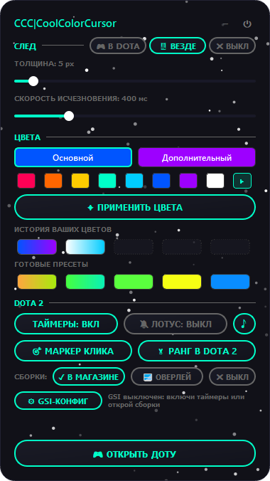 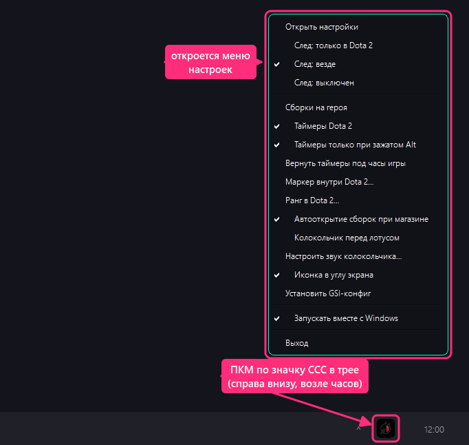

Сборки в магазине Dota — по позициям, с процентом покупок, прокачкой и талантами:

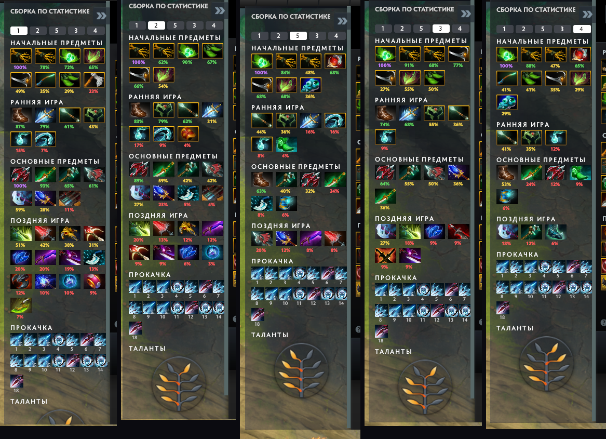

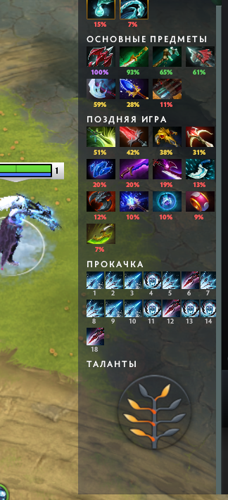 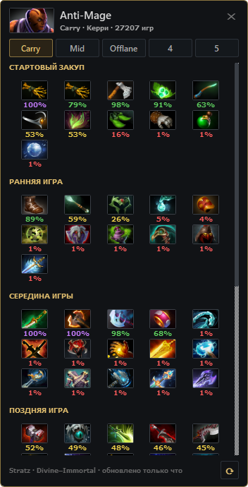

Свой вид ранга — пример набора CCC Simple в игре:

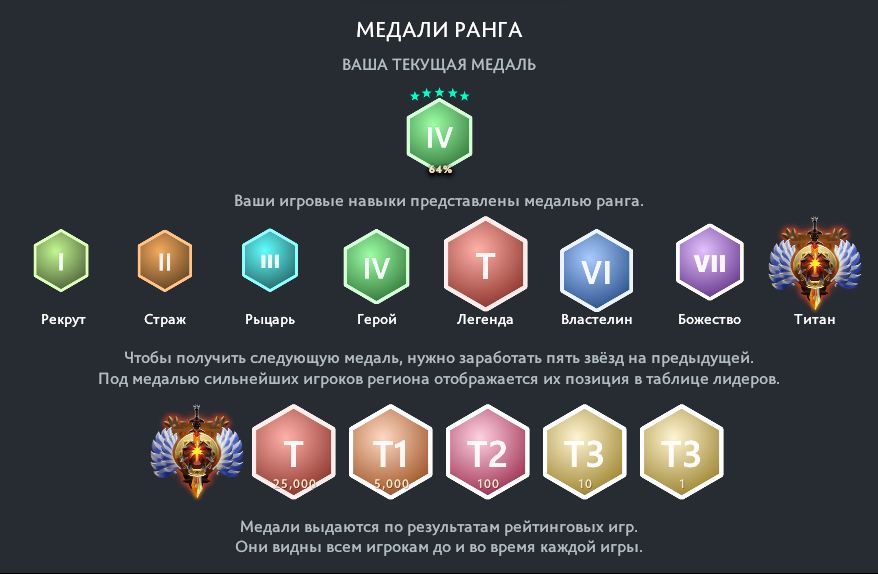

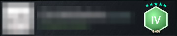

Как добавить свои иконки рангов:

1. «+ пак» — готовый `.vpk`, или «редактор» — свои картинки: 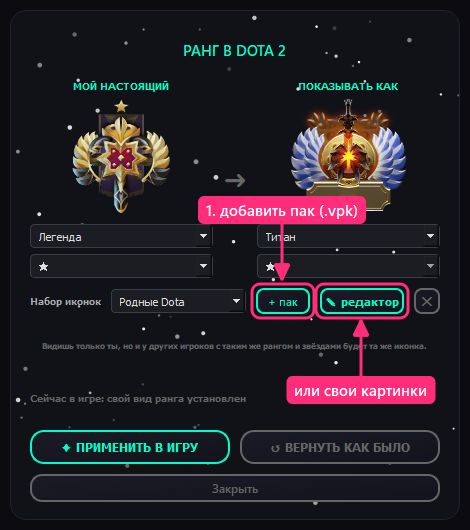
2. Выбрать пак: 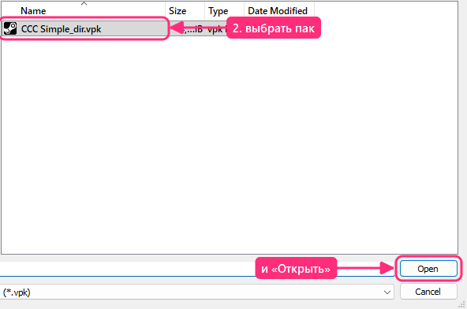
3. Набор выбран → «Применить в игру»: 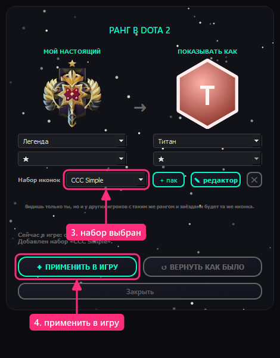
4. В редакторе клик по иконке — своя картинка любого размера, она сама встанет на место родной; для звёзд хватит одной звезды: 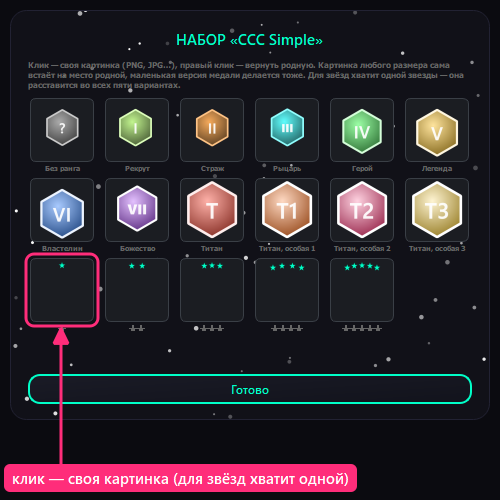
5. Выбрать картинку: 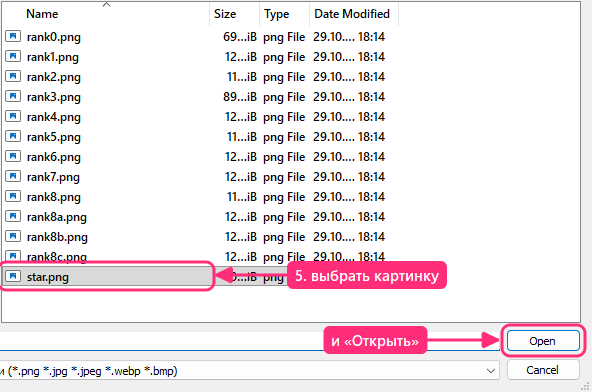

Наборы переключаются в списке: 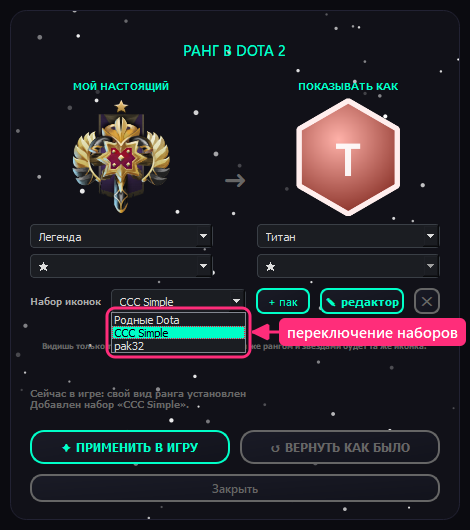

Маркер клика и звук лотуса:

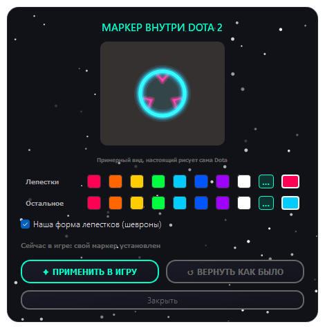 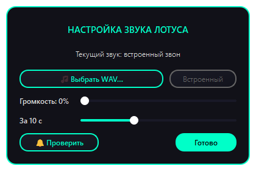

---

### Как скачать и запустить

1. Справа на странице репозитория откройте **Releases** → последнюю версию.
2. В блоке **Assets** скачайте **CCC.exe**.
3. Положите файл в удобную папку и запустите (установка не нужна). Настройки хранятся в `%APPDATA%\CCC`, поэтому новая версия, скачанная в любую папку, подхватит их сама.
4. Меню настроек — правой кнопкой по значку CCC в трее (справа внизу, возле часов).

Для маркера, рангов и сборок в магазине в параметрах запуска Dota 2 в Steam нужно добавить `-language russian`.

---

### ⚠️ Важно про моды Dota

Маркер клика, сборки в магазине и вид ранга работают через подмену файлов: программа кладёт свои паки в папку `game\dota_russian`. Файлы самой игры не меняются, кнопка «Вернуть как было» (для сборок — «Оверлей») удаляет наш пак.

**Используете на свой страх и риск: мы не несём никакой ответственности за ваш аккаунт.**

Подмена видна только вам. Ничего, что даёт преимущество в матче, программа не делает и делать не будет.

Если после обновления Dota что-то выглядит не так — закройте игру и запустите программу: паки пересоберутся из свежих файлов игры сами. Наши паки занимают номера начиная с 68 (`pak67` оставлен Minify); если номер занят другим модом, программа сама возьмёт следующий свободный и чужие паки не тронет.

---

### Для разработчиков

* Python 3 + PyQt5, запуск: `pythonw main.py`.
* Устройство проекта, что делать после патча Dota и журнал изменений — в [NOTES.md](NOTES.md).
* Сборка `.exe`: `pyinstaller CCC.spec`. Exe в релизах собирает GitHub Actions из кода тега (`.github/workflows/release.yml`), рядом лежит его SHA-256.

Dota 2 и её ресурсы (иконки, картинки интерфейса) принадлежат Valve Corporation. Проект не связан с Valve.
